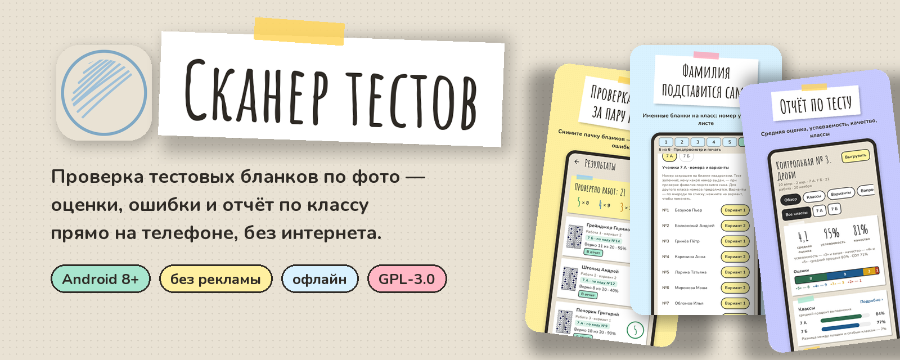
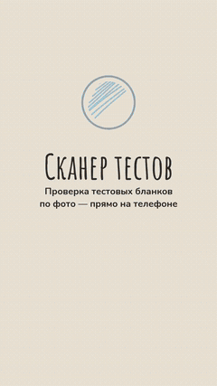
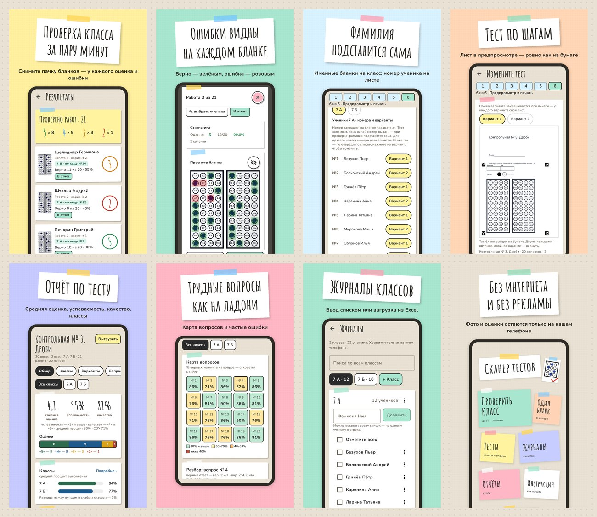

<p align="center">
  
</p>

<p align="center">
  <a href="https://www.rustore.ru/catalog/app/com.tscan.scanertestov"></a>
  
  
  <a href="LICENSE"></a>
</p>

<p align="center">
  <b>Учитель печатает бланки, ученики закрашивают кружки — а оценки, ошибки по вопросам<br>
  и отчёт по классу приложение считает само. Прямо на телефоне, без интернета.</b>
</p>

---

## Как это выглядит

<table>
  <tr>
    <td width="270" valign="top"></td>
    <td valign="top">

### Четыре шага

1. **Создайте тест.** Мастер из шести этапов: название, бланк, вопросы и кружки, правильные ответы, критерии оценки, предпросмотр и печать.
2. **Напечатайте бланки.** Обычный PDF, картинку в свой Word — или **именные бланки на весь класс** из журнала.
3. **Сфотографируйте работы.** Пачкой подряд камерой приложения или выберите фото из галереи.
4. **Получите результат.** У каждого ученика — оценка, число верных ответов и ошибки на самом бланке. Всё складывается в отчёт по тесту.

Нужно проверить одну работу сразу? **«Один бланк в камере»**: наведите телефон — оценка и пометки появятся прямо на листе.

</td>
  </tr>
</table>

<p align="center">
  
</p>

---

## Возможности

<table>
  <tr>
    <td width="50%" valign="top">

### 📸 Проверка класса
- Снимайте бланки подряд — камера сама находит лист по четырём угловым меткам.
- Фото из галереи, в том числе снятые с рук и под углом.
- У каждой работы — оценка, «верно N из M» и разбор ошибок на бланке.
- Исправленные ответы (закрашен и зачёркнут) распознаются; если приложение сомневается — спросит вас.

</td>
    <td width="50%" valign="top">

### 🎯 Один бланк в камере
- Наведите камеру — через секунду на листе зелёные «верно», красные «ошибка» и штриховка там, где был правильный ответ.
- Оценка красной ручкой, вариант синим, фамилия ученика — по коду на бланке.
- Пометки «приклеены» к листу и двигаются вместе с ним.

</td>
  </tr>
  <tr>
    <td valign="top">

### 📝 Тест по шагам
- Готовые и свои шаблоны бланков.
- До 35 вопросов, 2–6 ответов в вопросе, одна или две колонки.
- До 4 вариантов со своими ключами; лишние кружки убираются нажатием — для всех вариантов или только для одного.
- Несколько правильных ответов, строгая или частичная проверка, свои границы оценок.

</td>
    <td valign="top">

### 🏷️ Именные бланки
- На каждом бланке напечатаны фамилия и имя, а номер ученика закрашен квадратами.
- При проверке фамилия и класс подставляются сами — без ручного выбора.
- Варианты раздаются по очереди по списку; номера выдаются на весь тест.

</td>
  </tr>
  <tr>
    <td valign="top">

### 📊 Отчёты по тесту
- Средняя оценка, успеваемость, качество знаний, распределение оценок.
- Сравнение классов и вариантов.
- Карта трудности вопросов и самая частая ошибка.
- Выгрузка в **Excel** (ответы каждого ученика) и **PDF** для печати.

</td>
    <td valign="top">

### 👩‍🏫 Журналы классов
- Ввод списком или загрузка из Excel/CSV — с шаблоном и правилами заполнения.
- Поиск по всем классам, перевод в другой класс, удаление с возвратом.
- Инструкция с анимациями: как заполнять бланк, как снимать, как работать с вариантами.

</td>
  </tr>
</table>

---

## Точность распознавания

Каждый кружок проверяет нейросеть (MobileNetV2, вход 128×128), **дообученная на настоящих бланках этого приложения**. Она различает три состояния: *пусто*, *закрашен*, *исправлен*. Если нейросеть сомневается, приложение дополнительно сверяет темноту кружка.

| Условия | Результат |
|---|---|
| Ровный снимок, хороший свет, плотная закраска | **99,87 %** верно распознанных кружков (47 бумажных снимков, 3 760 кружков) |

Почти все ошибки — из-за способа закраски, поэтому в приложении есть раздел «Как заполнять бланк, чтобы проверка не ошибалась», который стоит показать ученикам.

---

## Ваши данные остаются у вас

- 🔒 **Всё считается на устройстве.** Нет аккаунтов, серверов и облачной проверки — приложению даже не нужно разрешение на интернет.
- 🚫 **Нет рекламы и аналитики.**
- 📁 Фото, журналы и результаты хранятся только в памяти приложения; снимки бланков и подписи учеников не попадают в резервную копию Android.

Подробнее — в [политике конфиденциальности](PRIVACY.md) (на русском и английском).

---

## Для разработчиков

<details>
<summary><b>Технологии</b></summary>

| | |
|---|---|
| Язык и интерфейс | Kotlin, Jetpack Compose (Material 3) |
| Камера | CameraX |
| Поиск бланка | OpenCV 4.12: угловые метки ArUco, гомография, оптический поток для слежения |
| Распознавание кружков | ONNX Runtime, MobileNetV2 128×128 (3 класса) |
| Чтение имён | PaddleOCR (кириллица) в ONNX |
| Excel и PDF | Apache POI, Android PdfDocument |
| Мин. версия | Android 8.0 (API 26), target API 35 |

</details>

<details>
<summary><b>Как собрать</b></summary>

1. Нужны JDK 17 и Android SDK (Android Studio подойдёт).
2. **Модели не хранятся в репозитории** (слишком большие). Положите их в `app/src/main/assets/models/` — что и откуда, описано в [`app/src/main/assets/models/README.md`](app/src/main/assets/models/README.md).
3. Отладочная сборка:
   ```bash
   ./gradlew assembleDebug
   ```
   APK: `app/build/outputs/apk/debug/app-debug.apk`.
4. Релизная сборка подписывается ключом из `keystore.properties` в корне проекта (файл не входит в репозиторий):
   ```properties
   storeFile=release.keystore
   storePassword=...
   keyAlias=...
   keyPassword=...
   ```
   ```bash
   ./gradlew assembleRelease
   ```

</details>

<details>
<summary><b>Устройство проекта</b></summary>

```
app/src/main/java/com/tscan/scanertestov/
├── feature/
│   ├── batch/         проверка класса: камера, очередь, распознавание, результаты
│   │   └── engine/    поиск сетки и меток бланка, нейросеть, подсчёт баллов
│   ├── live/          «Один бланк в камере»: слежение за листом, пометки поверх кадра
│   ├── tests/         «Мои тесты» и мастер теста, предпросмотр и печать, номера учеников
│   ├── blankeditor/   оформление и печать бланка (PDF, картинка, именные)
│   ├── reports/       отчёты по тесту, выгрузка в Excel и PDF
│   ├── journals/      журналы классов, загрузка из Excel/CSV
│   ├── instructions/  инструкция и анимации
│   └── settings/      настройки, критерии оценок
├── ml/                загрузка моделей
└── ui/                тема «Скрапбук», общие компоненты
sdk/                   OpenCV для Android
store/rustore/         тексты для RuStore, скрипты скриншотов, видео и картинок README
```

</details>

---

## Обратная связь

Вопросы, ошибки и предложения — **mr.kamanov@yandex.ru** или отзыв в [карточке приложения в RuStore](https://www.rustore.ru/catalog/app/com.tscan.scanertestov).

## Лицензия

[GNU GPL v3](LICENSE) © Сергей Каманов. Шрифты Amatic SC и Nunito — по лицензии SIL Open Font License (тексты лицензий в `app/src/main/assets/licenses/`).
